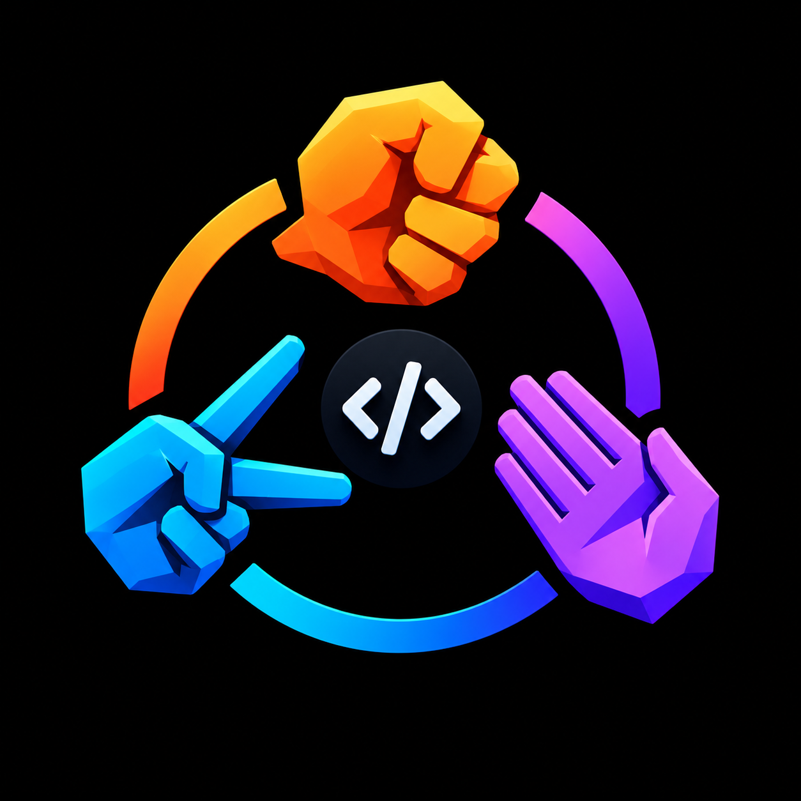
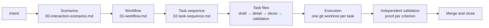

<p align="center">
  
</p>

<h1 align="center">Dev Cycle</h1>

<p align="center">
  <strong>From an intent to merged code, through documents an agent can pick up at any point.</strong><br>
  A development cycle for coding agents: plan, write task files, implement and validate in
  git worktrees, merge.
</p>

<p align="center">
  <a href="CHANGELOG.md"></a>
  <a href="LICENSE"></a>
  
  
  <a href="https://agentskills.io/specification"></a>
</p>

<p align="center">
  Created by <a href="https://pavelbender.com">Pavel Bender</a> ·
  <a href="https://github.com/pavelbender">@pavelbender</a>
</p>

---

## What it is

Dev Cycle is a set of agent skills that carries a feature through a sequence of stages, sized
to the work.
Each stage writes a document into the repository, and the next stage reads it. The state of
the work lives in those files, not in a chat: stop at any point, open a new session a week
later, name the bundle, and the cycle continues from where the files say it is.



What that gives you:

- **Resumable work.** The stage is detected from files and task frontmatter. Nothing depends
  on chat memory.
- **Small, checkable tasks.** A feature becomes a dependency graph of tasks, each with one
  deliverable, its own acceptance criteria and its own test commands.
- **Parallel execution without collisions.** Tasks with disjoint work areas run at the same
  time, each in its own git worktree, and merge one at a time.
- **Validation by a second agent.** A task is accepted by a fresh agent that proves every
  criterion from code, tests and command output. It did not write the code.
- **The right model for each role.** An architect, a developer, a validator and a researcher
  run on different models and effort levels, and the project records which ones actually
  worked.
- **Bug fixes sized to the bug.** A one-line cause is fixed directly with a regression test.
  A cross-layer one gets a developer and an independent check. A design gap becomes a
  planned change.
- **Hands-off modes.** An autopilot that asks nothing, and four scheduled agents that fix
  known issues and advance the backlog on their own branches.

> **Status: early.** Version 0.7.1. The skills are used on real projects, and the scripts
> have tests, but the prompts have no automated evaluation suite yet. Expect rough edges and
> read the [changelog](CHANGELOG.md) before you update.

## Contents

- [Quick start](#quick-start)
- [Commands](#commands)
- [How a feature moves](#how-a-feature-moves)
- [The bundle](#the-bundle)
- [Roles, models and delegation](#roles-models-and-delegation)
- [Consilium](#consilium)
- [Scheduled agents](#scheduled-agents)
- [Project profile](#project-profile)
- [Requirements](#requirements)
- [Install, update, uninstall](#install-update-uninstall)
- [Repository layout](#repository-layout)
- [Tests](#tests)
- [Changelog, license, author](#changelog-license-author)

## Quick start

1. Install the plugin.

   ```sh
   # Claude Code
   claude plugin marketplace add pavelbender/dev-cycle-skills --scope user
   claude plugin install dev-cycle@dev-cycle-skills --scope user

   # Codex
   codex plugin marketplace add pavelbender/dev-cycle-skills
   codex plugin add dev-cycle@dev-cycle-skills
   ```

2. Tell it about your project. Paste [`examples/AGENTS.dev-cycle.md`](examples/AGENTS.dev-cycle.md)
   into the root `AGENTS.md` (or `CLAUDE.md`) and edit the commands and paths. Its section
   "Explaining to the owner" is the only part that reaches plain chat, where no skill is
   loaded: keep it.

3. Open a new session and give it an intent.

   ```text
   /dev-cycle:cycle let users void an invoice from the billing console
   ```

   The cycle proposes a bundle path, writes the scenarios, the workflow and the task
   sequence, and stops at each point that needs your decision. To continue later:

   ```text
   /dev-cycle:cycle docs/tasks/billing/void-invoice
   ```

## Commands

Five commands. Everything else runs through them.

| Command | What it does |
| --- | --- |
| `/dev-cycle:cycle <intent or bundle path>` | drives a feature through the stages, or runs one stage |
| `/dev-cycle:fix <bug report>` | fixes a bug by the shortest path its cause allows |
| `/dev-cycle:consilium <question>` | seats 4–5 role agents on one hard cross-domain question |
| `/dev-cycle:probe-paths [focus]` | probes a live stand for dead ends, missing reverse actions and role/permission holes; records, fixes nothing |
| `/dev-cycle:automation install` | sets up the scheduled agents for the current repository |

In Codex the prefix is `$`: `$dev-cycle:cycle <intent or bundle path>`.

### `cycle`

| Option | Effect |
| --- | --- |
| `--plan` | planning only: stop when every task file has its four passes |
| `--task <TNN,…>` | only these tasks: their missing planning passes, then execution and validation |
| `--until <stage>` | stop after `scenarios`, `workflow`, `sequence`, `drafts`, `detail`, `slices`, `validation` or `execution` |
| `--no-stop` | skip confirmation gates; real questions and failures still stop |
| `--auto` | autopilot: asks nothing, decides open questions itself, lists every decision in the report |

`cycle` is also the entry to a single stage. Ask in plain words:

```text
/dev-cycle:cycle plan the scenarios for the invoice console
/dev-cycle:cycle detail T05
/dev-cycle:cycle validate T07
/dev-cycle:cycle tidy docs/tasks/billing
```

**Gates.** Without options the cycle stops for the bundle path of a new intent, a topic
choice, a blocking owner question, a replan signal, a failed validation, the batch plan
before execution, and the merge into your working branch.

**Autopilot.** `--auto` takes the recommended option at every gate and records each choice
where its question was, as `autopilot: <choice> — <reason>`. It never pushes, deploys,
releases or publishes, and never touches production, secrets, credentials, customer data or
an applied migration: those steps are skipped and listed in the report.

### `fix`

Describe the bug in any form: a sentence, a screenshot, an error text, a log, a failing test.
You can also just say it in the chat; the skill loads on a bug report without the command.

```text
/dev-cycle:fix deleting a role fails with "Failed to delete role", screenshot attached
```

The agent writes down the defect, reproduces it and traces it to the root cause. Only then
does it choose how heavy the fix has to be, from the cause and not from the wording of the
report:

| Path | Taken when | What happens |
| --- | --- | --- |
| direct | one cause in one component; the fix and its test stay within five files | the agent fixes it itself: failing test, fix, rerun of the reproduction. No documents, no subagents |
| briefed | several layers or more than five files; or the fix changes an authorization check, a schema, or code that deletes or rewrites stored data | a developer agent fixes it in its own worktree from a written brief; a second agent checks it without seeing the developer's report |
| planned | more than one unit of work; a contract changes and its consumers must follow; stored data needs repair; the correct behaviour was never specified | the bug becomes a bundle and goes through `cycle` |

The path can change on the way. A direct fix that reaches a sixth file or a schema moves up
to briefed. A check that still fails after two attempts sends the agent back to the search
for the cause; it does not try a third variant. A fix that turns out to be one change in one
component moves down to direct. The search for the cause is sized the same way: a direct
trace first, then up to three ranked hypotheses, then `git bisect`, temporary logging and
parallel researchers, then the advisor or a consilium.

| Option | Effect |
| --- | --- |
| `--diagnose` | find and report the cause and the path; change no code |
| `--auto` | ask nothing; a bug that cannot be reproduced or isolated is recorded and the run ends |

A bug that is left open goes into the project's `known_issues` file when the profile has
one, and a fixed one is removed from it.

## How a feature moves

| # | Stage | Produces | Stage skill | Role |
| --- | --- | --- | --- | --- |
| 1 | scenarios | `00-interaction-scenarios.md`; skipped when no screen or CLI flow is involved | `plan-scenarios` | UI/UX expert |
| 2 | workflow | `01-workflow.md`: target model, invariants, decisions | `plan-feature` | system architect |
| 3 | sequence | `02-task-sequence.md`: tasks, dependencies, proof points | `plan-feature` | system architect |
| 4 | drafts | a stub file per task | `write-task` | solution architect |
| 5–6 | detail, slices | each task verified against the code; subagent-ready items marked | `write-task` | solution architect |
| 7 | validation | one checkable case per criterion, exact test commands | `write-task` | QA developer |
| 8 | execution | code, tests and docs per task; a validation verdict per task | `run-bundle` → `execute-task`, `validate-task` | developer, QA developer |
| 9 | close | evidence for every proof point; the bundle moved to `_completed/`; branches merged | `tidy-folder` | release manager |

The table is the full route. `cycle` takes it when the work carries a hard signal: a schema
or migration, authorization, a wire contract, stored data, or more than one consumer.
Without one it runs the planning passes together and keeps the documents short. Visual work
(a landing page, a screen built to a design) plans only the constraints and the checks; the
developer renders the result early, compares it with the reference and improves it, and the
screenshots go to `evidence/` for the owner.

The stage skills are read by `cycle`; they are not commands of their own. Two contracts
apply throughout: `task-layout` (document layout, identifiers, frontmatter, the project
profile, delegation rules) and `coding-rules` (code structure rules `cs-001`…`cs-028`, which
also load on their own whenever the agent writes code).

Planning runs in waves: task files with no dependency between them are written in parallel.
Execution runs in batches: ready tasks with disjoint work areas each get a worktree and a
developer, then an independent QA developer, and merge into the bundle branch one at a time.

## The bundle

One directory holds everything about one feature.

```text
<tasks_root>/<domain>/<feature-slug>/
  00-interaction-scenarios.md   # optional
  01-workflow.md
  02-task-sequence.md           # source of truth for task IDs and dependencies
  tasks/
    T01-<task-slug>.md
    T02-<task-slug>.md
  evidence/
    P01-<proof-slug>.md
```

Every task file starts with frontmatter that a script can read:

```yaml
---
id: T02
status: done            # formed | in_progress | review | done | validated | withdrawn
blocked_by: [T01]
blocks: [T05, T08]
milestone: P01
pass: validation        # draft | detail | slices | validation
---
```

A task is ready when everything in `blocked_by` is `done` or `validated`. Readiness comes
from the graph, never from file numbers. `TNN` are tasks, `PNN` are proof points with their
evidence files, `SNN` are subagent-ready items inside a task. Published IDs are never
renumbered.

`plugins/dev-cycle/skills/task-layout/scripts/bundle-status.sh <bundle>` prints the status
map, the dependency waves and the current stage of any bundle. Given a domain folder, it prints every
open bundle under it. Each task row carries its status, `signals` and title.

## Roles, models and delegation

Work is delegated by role, and each role starts on the cheapest model and effort that is
known to do it well.

| Tier | Claude Code | Codex | Used for |
| --- | --- | --- | --- |
| deep | `fable` | newest Astra | architecture, the hardest design work |
| strong | `opus` | newest Sol | task design against code, cross-layer work, debugging |
| everyday | `sonnet` | newest Terra | implementation, validation, tests |
| light | `haiku` | newest Luna | lookups, evidence packs, merges |

- **Observed results beat vendor claims.** The coordinator keeps a model-notes file per
  project: role, model, effort, task kind, outcome. Three like-for-like observations override
  the starting values.
- **One place for the rules.** When to delegate and what it costs, how deep subagents may
  nest, how big one unit of work should be, what runs in parallel, and how to brief a
  subagent are all in
  [`roles-and-models.md`](plugins/dev-cycle/skills/task-layout/references/roles-and-models.md).
- **One committer per tree.** Parallel writers work in separate worktrees, or on disjoint
  files with the parent committing.
- **Read-only where it matters.** In Claude Code the plugin ships two agent types,
  `dev-cycle:researcher` and `dev-cycle:consilium-member`, whose tools cannot edit files or
  run commands.

The model and effort values follow Anthropic's prompting guides for the current Claude
models; [`docs/anthropic/README.md`](docs/anthropic/README.md) maps each guide statement to
the place where the plugin applies it.

Claude Code nests subagents three layers deep by default, which is what the skills are built
for. A fourth layer needs `CLAUDE_CODE_MAX_SUBAGENT_SPAWN_DEPTH=4` in the `env` block of
your `settings.json`; a plugin cannot set it.

## Consilium

Some questions are too wide for one agent: they span several functional domains of the
product, and no single role sees every consequence. A consilium answers them.

1. The chair frames one neutral question with its constraints and evidence paths.
2. Four or five role agents study it independently, each from its own lens, without seeing
   each other. They are read-only.
3. If they disagree, one challenge round: every member gets the other positions and answers
   them.
4. The chair checks the evidence, decides, and records the decision with the dissent and the
   fact that would reopen it.

It is the most expensive decision tool of the set, so it sits last on a ladder: evidence
first, then the host's advisor when it has one, then a consilium. It prepares options for the
owner; it never replaces an owner decision.

## Scheduled agents

Claude Code only. Four unattended agents work on a repository while you do something else.
Each run takes one item, works in its own worktree and branch, writes a report and a ledger
row, and stops. Nothing is pushed or merged into your working branch: you review the reports
and merge the branches.

| Agent | Default interval | One run | Model, effort |
| --- | --- | --- | --- |
| `collect-issues` | 6 hours | collects untracked defects into the known-issues file | `sonnet`, `high` |
| `collect-backlog` | 6 hours | collects deferred and undone work into the backlog | `sonnet`, `high` |
| `autodebug` | 30 minutes | fixes one known issue | `opus`, `high` |
| `autobacklog` | 30 minutes | advances one backlog item, a whole feature through `cycle` if needed | `opus`, `medium` |

```text
/dev-cycle:automation install --work 60m --collect 12h
```

`automation` checks the project profile, plans the start times so that the collectors feed
the workers, dry-runs each agent, installs them (Task Scheduler on Windows, cron on Linux and
macOS) and explains the routine it expects from you. The same skill does `status`, `pause`,
`resume`, a new interval and `uninstall`, for all agents or one.

One agent at a time:

```text
/dev-cycle:automation install --jobs autodebug --work 60m    schedule one agent
/dev-cycle:automation run collect-issues                     one run now, outside the schedule
/dev-cycle:automation dry-run autobacklog                    show what it would pick, change nothing
/dev-cycle:automation pause autodebug                        also: resume, uninstall
```

Intervals are minutes that divide an hour (`5m`, `10m`, `15m`, `20m`, `30m`) or whole hours
that divide a day (`1h`, `2h`, `3h`, `4h`, `6h`, `8h`, `12h`, `24h`).

> **Warning.** The scheduled agents run with `--permission-mode bypassPermissions`: every
> command the agent decides to run executes as your user without a prompt. Install them only
> on a machine and a repository where that is acceptable.

## Project profile

Project facts come from the project, never from the skills. The cycle reads them from a
`## Dev cycle` section of the root `AGENTS.md` (or `CLAUDE.md`).

| Key | Meaning |
| --- | --- |
| `tasks_root` | where bundles live; default `docs/tasks/` |
| `format`, `lint`, `test` | the project's commands; `test` takes `{path}` |
| `stand` | optional: commands that raise a runtime environment and smoke-test it |
| `wip_branch`, `bundle_branch`, `task_branch` | where finished work lands and how branches are named |
| `worktree_root`, `worktree_setup` | where task worktrees are created and how dependencies are installed |
| `decisions`, `glossary` | decision records and domain terms, when the project keeps them |
| `boundaries` | one rule that every subagent brief carries |
| `known_issues`, `backlog` | the files the scheduled agents read and feed |
| `jobs_state`, `job_notes`, `model_notes` | state and project notes of the scheduled agents and the coordinator |

The full list with defaults is in
[`task-layout`](plugins/dev-cycle/skills/task-layout/SKILL.md#project-profile); a filled
example is in [`examples/AGENTS.dev-cycle.md`](examples/AGENTS.dev-cycle.md).

## Requirements

| Component | Needed for | Notes |
| --- | --- | --- |
| git | everything | worktrees are used for execution |
| Claude Code | the full feature set | developed and checked with 2.1.322. Effort per subagent call needs 2.1.292 or later; without it subagents run at their model's default effort |
| Codex | the skills | the same skill files; the scheduled agents and the two read-only agent types are Claude Code only |
| bash | `bundle-status.sh`, the tests | on Windows use Git Bash; without bash the skills build the status map by hand |
| PowerShell 7 | scheduled agents on Windows | with Task Scheduler |
| cron | scheduled agents on Linux and macOS | |

## Install, update, uninstall

Install for one project only: run the Claude Code commands from its root with
`--scope project`; for Codex see [`examples/codex-project.toml`](examples/codex-project.toml).

```sh
# Update
claude plugin marketplace update dev-cycle-skills
claude plugin update dev-cycle@dev-cycle-skills --scope user

codex plugin marketplace upgrade dev-cycle-skills
codex plugin add dev-cycle@dev-cycle-skills
```

```sh
# Uninstall
claude plugin uninstall dev-cycle@dev-cycle-skills --scope user
claude plugin marketplace remove dev-cycle-skills --scope user

codex plugin remove dev-cycle@dev-cycle-skills
codex plugin marketplace remove dev-cycle-skills
```

Remove the scheduled agents with `/dev-cycle:automation uninstall` before you uninstall the
plugin; they run the installed copy.

Without the plugin system, `scripts/install.sh` links the skills into a skills directory
(`codex-user`, `codex-project <repo>`, `claude-user`, `claude-project <repo>`).

## Repository layout

```text
plugins/dev-cycle/
  skills/          cycle, fix, consilium, probe-paths, automation; the stage skills; the two contracts
  agents/          researcher and consilium-member: read-only agent types (Claude Code)
  agent-jobs/      the runner for scheduled agents (sh, ps1), common rules, one file per job
  assets/          the icon
examples/          a project profile to paste; a Codex project config
docs/anthropic/    how the plugin maps to Anthropic's prompting guides
tests/             tests for the runner and the status script
scripts/           install.sh for a setup without the plugin system
```

## Tests

```sh
bash tests/test_bundle_status.sh                    # status map, waves and stage on fixture bundles
bash tests/test_agent_job.sh                        # cron schedules, model pinning, prompt composition
pwsh -NoProfile -File tests/test_agent_job.ps1      # the same for the Windows runner
claude plugin validate plugins/dev-cycle            # manifest and frontmatter
```

The runner tests use a stub scheduler and a stub `claude` in a temporary profile; they do not
touch your crontab, Task Scheduler or Claude Code settings.

## Changelog, license, author

- [Changelog](CHANGELOG.md)
- License: [MIT](LICENSE)
- Author: [Pavel Bender](https://pavelbender.com)

Dev Cycle is an independent project. It is not affiliated with or endorsed by Anthropic or
OpenAI. Claude, Claude Code and Codex are names of their respective owners.
