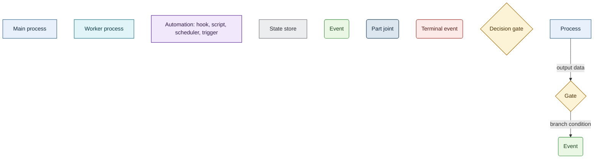

# Process diagram convention

Every process map in a bundle is a Mermaid `flowchart TD` block drawn with one fixed vocabulary:
eight semantic node classes, a fixed palette, and edge labels that mean different things depending on
what the edge leaves. The point of fixing it is that a reader who has decoded one diagram has decoded
all of them, and an author never has to invent a colour.

## The vocabulary

Eight classes, and nothing else. The class carries the meaning; the shape reinforces it.

| Class | Shape | Colour | Means |
| --- | --- | --- | --- |
| `proc` | rectangle | blue | Main process: what the actor or service the diagram is about does itself |
| `work` | rectangle | teal | Worker process: work handed to another process, such as a background job or a queue consumer |
| `auto` | rectangle | violet | Automation element: hook, script, scheduler, trigger |
| `store` | rectangle | grey | State store: table, file, queue, cache, event log |
| `evt` | stadium | green | Event |
| `io` | stadium | steel grey | Part joint: the exit of one part and the entry of the next |
| `stop` | stadium | red | Terminal event: pause, refusal, premature exit |
| `gate` | diamond | amber | Decision gate |

A rectangle is therefore always a *doing* node and its colour says *who* does it; a stadium is
always a *state reached* and its colour says whether the flow continues, joins another part, or ends.

## The palette

Copy the block verbatim. Declare only the classes the diagram actually uses, and never restyle a
single node with `style`.

```text
classDef proc fill:#E8F1FB,stroke:#2C5F8A,stroke-width:1.2px,color:#12293D
classDef work fill:#E1F4F7,stroke:#177281,stroke-width:1.2px,color:#0B3A42
classDef auto fill:#F1E9FB,stroke:#6B3FA0,stroke-width:1.4px,color:#2E1A4A
classDef store fill:#ECEDEF,stroke:#6E6E76,stroke-width:1.2px,color:#2B2B30
classDef evt fill:#E9F7E4,stroke:#3E8E41,stroke-width:1.2px,color:#1E4620
classDef io fill:#DCE6EE,stroke:#3F5B72,stroke-width:1.6px,color:#12293D
classDef stop fill:#FBEAE7,stroke:#A33B32,stroke-width:1.3px,color:#5A1E17
classDef gate fill:#FCF3D7,stroke:#A87413,stroke-width:1.3px,color:#4A3208
```

The two thicker strokes are deliberate: `auto` at `1.4px` and `io` at `1.6px`. Automation and part
joints are the two things a reader scans for, so they carry the heaviest outline.

## The rendered legend

The vocabulary drawn in its own terms, including the two sample edges. This block is the legend for
every process map; render it next to a diagram whose reader has not seen the convention before.



## Nodes

- `["…"]` for `proc`, `work`, `auto`, `store`; `("…")` for `evt`, `io`, `stop`; `{"…"}` for `gate`.
- Always quote the label. Labels carry colons, commas, dots and flag syntax, and an unquoted label
  breaks the parse on the first `:`.
- `<br/>` for line breaks. Prefer two or three short lines over one long one; a node wider than the
  gate above it forces the whole graph sideways.
- Name the real thing. A node says `POST /invoices/{id}/void`, `billing-worker: retry, timeout
  600 s`, `invoices.status = 'void'` — the operation, the job, the timeout, the column, verbatim as
  the code spells it. A node that says "calls the service" is a node that will silently go stale.
- A gate label is a question with a `?`. If the question cannot be answered from state the diagram
  has already produced, the gate is in the wrong place.

## Edges

The label's meaning follows from what the edge *leaves*:

| Edge | Label carries |
| --- | --- |
| From a gate | The condition under which this branch is taken |
| From a process | The output data the process produced |
| Unlabelled `-->` | Nothing to carry: an unconditional handover, e.g. `IO1 --> G1`, `E1 --> P1` |
| Dashed `-.->` | A data link with no transfer of control |

Rules:

- Every branch of every gate is drawn and labelled. A gate with an undrawn branch is a lie about the
  flow, not an omission. Branches fan out on the condition in the reader's terms, not on the boolean:
  `G1 -->|"invoice already paid"| P1` and `G1 -->|"no permission to void"| P2` beat a pair of edges
  labelled `false` and `true`.
- A dashed edge is rare. Example: `H7 -.->|"read by the nightly report"| H8`: the store is read by
  something this flow never starts. Reach for `-.->` only for that shape of fact.

## Splitting a document into parts

One diagram per part; one part per section. Parts are chained by their process inputs and outputs —
**the exit event of one part is the entry event of the next**.

- The document opens with a parts map: a table of `part | input | output`, one row per diagram. It is
  the only place a reader can see the whole chain at once, and it is what makes several separate
  diagrams one document.
- A part that continues the chain opens with an `io` node labelled `In: …` and closes with an `io`
  node labelled `Out: …`, whose text repeats the parts-map row.
- A part that has no upstream or no downstream carries no `io` nodes: a part that starts at a user
  request, or a fan of independent trigger → automation chains sharing one `store`. These are
  boundary parts, and forcing a joint onto them would invent a predecessor that does not exist.
- Parts are separated by `---`.

## Layout inside a block

```text
flowchart TD

<node declarations>

<edges>

<classDef block>

<class assignments>
```

Declarations first, all of them, then edges, then the palette, then the `class` lines — separated by
blank lines. In a fan diagram, group declarations by trigger and put a blank line between groups, and
group the edges the same way, so the groups read as the independent chains they are.

`flowchart TD` in every block. No `subgraph`, no `linkStyle`, no `LR`.

## Node ids

Ids are a local reading aid, not part of the convention: they are re-used from part to part and mean
nothing across diagrams. The habit is `E` for events, `P` for main processes, `H` for
automation, `G` for gates, `IO` for joints, `S`/`LOG` for stores, `W` for workers, and it is only a
habit. **Read the `class` lines, never the prefix.** Keeping ids short and dense is worth more than
keeping them systematic.

## The prose around a diagram

A part is a diagram plus a short prose block, for example "What matters in this part". The diagram
carries the flow; the prose carries what a box cannot: why a timeout is what it is, what the previous
design got wrong, which service is the single writer of a table.
Prose cites `path:line`. If a fact fits in a node, it belongs in the node, not in the prose.

## Checklist before committing a diagram

- [ ] `flowchart TD`; no `subgraph`, no `linkStyle`.
- [ ] Every node has a class; every class used is declared; nothing else is declared.
- [ ] Palette lines are byte-identical to the block above.
- [ ] Every label is quoted; every wrap is `<br/>`.
- [ ] Every gate is a question, and every branch of it is drawn and labelled with its condition.
- [ ] Every labelled process edge names the data it hands on.
- [ ] The part opens and closes on `io` nodes whose text matches its parts-map row — or it is a
      boundary part with neither.
- [ ] Commands, paths, flags and timeouts in nodes match the source they name.
- [ ] Node text is in the host document's language.
