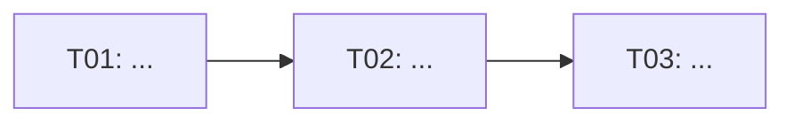

# Template `02-task-sequence.md`

Section names: keep those a bundle already uses; otherwise these. The opening paragraph, key
risks and anything the user reads in the user's language; impact map, task cards and proof
commands in compact English. This document is the source of truth for `TNN`, `PNN`,
`Depends on` and task/evidence paths; task frontmatter `blocked_by`/`blocks` must match its
`Depends on`/`Unlocks` columns.

````md
# Task sequence: <feature>

<Why the workflow is not one task and what the first complete milestone is. Planned on
`<commit>` (`<branch>`).>

## Impact map

| Layer | Current state | Required change | Risk/invariant |
| --- | --- | --- | --- |

## Dependency flow



## Implementation order

1. `T01` — ...
2. `T02` and `T03` in parallel after `T01`.

## Reference documents

- [`01-workflow.md`](01-workflow.md)
- `<decision records, schemas, guides>`

## Main decomposition

| ID | Task | Checkable deliverable | Depends on | Unlocks |
| --- | --- | --- | --- | --- |
| T01 | ... | ... | — | T02, T03 |

## Task catalogue

### T01. <task name>

Goal: <one observable outcome>.

Description: <what changes and why, without an open solution space>.

Task file: `tasks/T01-<slug>.md`.

Deliverable: <migration, schema, command, UI capability, report>.

API / contract: <exact operation, schema, CLI, or "Not required">.

In scope:

- <concrete outcomes and invariants>

Out of scope:

- <neighbouring work left to another task>

Depends on: <T00 / finished work with its document or commit / none>.

Unlocks: <IDs or a concrete outcome>.

Check:

- <test, contract check, smoke or manual acceptance>.

## Proof points

### P01. <name, after T01–T03>

- Proves: `T01`, `T02`, `T03`.
- Scenario: <checkable vertical slice>.
- Proof: <commands, API calls, smoke steps>; report: `evidence/P01-<slug>.md`.
- Expected: <observable success and a critical negative condition>.

## Future tasks

### F01. <name>

<Deferred scope, reason, prerequisites.>

## Recommended first implementation batch

<IDs that give the first complete useful vertical slice, not just the first N.>

## Key risks to keep explicit in task files

- <Risk and the rule that must not stay implicit.>
````
